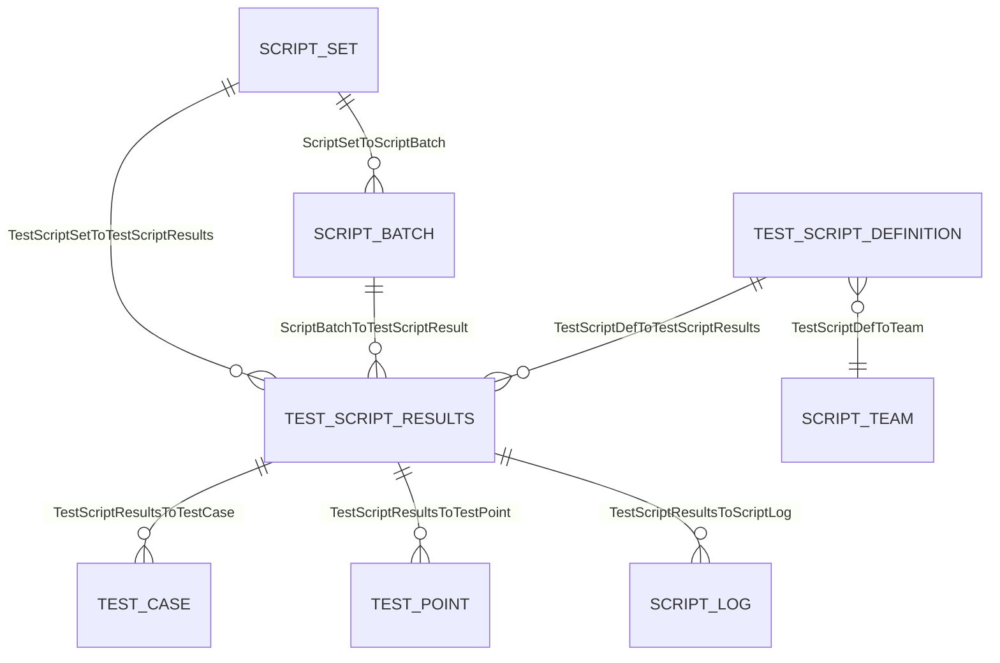
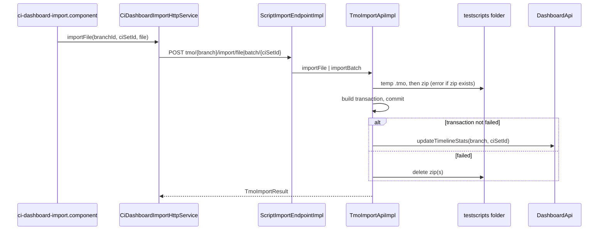

# Zenith (CI Dashboard)

Every statement below was read from the cited code. Where the code does not settle a question, the doc says so. Paths are relative to the repo root. `TS` = `plugins/org.eclipse.osee.testscript/src/org/eclipse/osee/testscript`, `WEB` = `web/apps/osee/src/app/ci-dashboard`.

## Where data is stored

| Data | Location | Source |
|---|---|---|
| Script sets, definitions, results, test points, batches, teams, timelines, configuration | OSEE artifacts on a branch | `CoreArtifactTypes.java` lines 871-1025 |
| TMO files | Zip files under `<OSEE_APPLICATION_SERVER_DATA>/testscripts/` | `TS/internal/TmoFileApiImpl.java` 27-36 |
| Branches shown in the Zenith picker | Branches carrying branch category id `4` (`CoreBranchCategoryTokens.CI`) | `CoreBranchCategoryTokens.java` 28; `WEB/lib/components/ci-dashboard-controls/ci-dashboard-controls.component.ts` (`category="4"`) |
| Demo CI category assignment | `CreateDemoBranches.java` 74 sets `CoreBranchCategoryTokens.CI` on `DemoBranches.SAW_PL` | `plugins/org.eclipse.osee.orcs.core/.../CreateDemoBranches.java` |

TMO zip paths (`TmoFileApiImpl.java` 65-82):

| Kind | Path under `.../testscripts/` |
|---|---|
| Single file | `<ciSetId>/<scriptName>_<executionDateMillis>.zip` |
| Batch member | `<ciSetId>/<batchId>/<scriptName>_<executionDateMillis>.zip` |

The zip holds one entry named `<scriptName>.tmo` (`TmoImportApiImpl.moveFileToZip`, 434-442). The result artifact stores the relative path in its `ContentUrl` attribute (`ScriptResultToken.createArtifact` 645; `setFileUrl(fileName)` at `TmoImportApiImpl` 168 and 285).

## Artifact types

Defined in `plugins/org.eclipse.osee.framework.core/src/org/eclipse/osee/framework/core/enums/CoreArtifactTypes.java`.

| Artifact type | Line | Attributes (cardinality as declared) |
|---|---|---|
| Script Configuration | 871 | `TestResultsToKeep` (exactlyOne) |
| Script Set | 874 | `Active` (zeroOrOne) |
| Test Script Definition | 877 | `ScriptName`, `MachineName`, `Revision`, `RepositoryType`, `LastAuthor`, `LastModifiedDate`, `ModifiedFlag`, `RepositoryUrl`, `ScriptSubsystem` (exactlyOne each); `PropertyKey` (atLeastOne); `ExecutionDate`, `ExecutionEnvironment`, `Notes`, `Safety`, `Scheduled`, `ScheduledTime`, `ScheduledMachine`, `StatusBy`, `StatusDate` (zeroOrOne) |
| Test Script Results | 899 | `SetId`, `ProcessorId`, `ExecutionDate`, `MachineName`, `PassedCount`, `FailedCount`, `ScriptAborted`, `ElapsedTime`, OS/Java/OSEE version attributes, `UserId`, `UserName`, `Email`, `QualificationLevel` (exactlyOne each); `RuntimeVersion` (atLeastOne); `Witness` (any); `Result`, `ScriptHealth`, `InteractiveCount`, `StartDate`, `EndDate`, `ExecutedBy`, `ExecutionEnvironment` (zeroOrOne) |
| Test Point | 936 | `TestNumber` (exactlyOne); result, group, expected/actual, requirement and similar attributes (zeroOrOne/any) |
| Test Case (`Script Test Case`, `Test Case Initial`, `Test Case Cleanup` subtypes) | 748, 929-934 | `TestNumber` on `Script Test Case` |
| Script Batch | 1007 | `BatchId`, `ExecutionDate`, `MachineName` (exactlyOne); `TestEnvBatchId` (zeroOrOne) |
| Script Timeline | 962 | `UpdatedAt`, `SetId`, `TimelineData` (exactlyOne each) |
| Script Team | 1023 | `UserId` (any); `IsDefault` (zeroOrOne) |
| Script Subsystem | 1021 | none declared |

The Zenith configuration artifact `ZenithConfiguration` (id 356555247) sits in folder `ZenithConfigFolder` (`ZenithArtifactTokens.java` 26-28). `CreateSystemBranches.java` 141-144 creates both and sets `TestResultsToKeep` to 10.

## Relation types

Defined in `CoreRelationTypes.java`.

| Relation | Line | Multiplicity | Side A | Side B |
|---|---|---|---|---|
| `TestScriptDefToTestScriptResults` | 264 | ONE_TO_MANY | Test Script Definition | Test Script Results |
| `TestScriptSetToTestScriptResults` | 268 | ONE_TO_MANY | Script Set | Test Script Results |
| `ScriptSetToScriptBatch` | 289 | ONE_TO_MANY | Script Set | Script Batch |
| `ScriptBatchToTestScriptResult` | 293 | ONE_TO_MANY | Script Batch | Test Script Results |
| `TestScriptDefToTeam` | 277 | MANY_TO_ONE | Test Script Definition | Script Team |
| `TestScriptResultsToTestCase` | 281 | ONE_TO_MANY | Test Script Results | Test Case |
| `TestScriptResultsToTestPoint` | 285 | ONE_TO_MANY | Test Script Results | Test Point |
| `TestScriptResultsToScriptLog` | 273 | ONE_TO_MANY | Test Script Results | Script Log |

Script Timeline and Script Set are linked by the `SetId` attribute, not by a relation (`DashboardApiImpl.getTimelineStatsToken` 91-94 queries `ScriptTimeline` by `SetId`). The `ScriptSubsystem` on a definition is an attribute in `CoreArtifactTypes` (line 896).



## Import

Client: `WEB/lib/services/ci-dashboard-import-http.service.ts` 24-45. A file whose name ends in `.zip` is posted to `/script/tmo/{branch}/import/batch/{ciSetId}`; any other file goes to `/script/tmo/{branch}/import/file/{ciSetId}`. The import page file input accepts `.tmo, .zip` (`ci-dashboard-import.component.html`). `CiDashboardImportService` (`ci-dashboard-import.service.ts`) sends nothing until the branch id is valid and a CI Set id other than `-1` is selected.

Server: `TS/ScriptImportEndpoint.java` (`@Path("import")`, reached through `TmoEndpoint` `{branch}/import`) exposes `file/{ciSetId}`, `batch/{ciSetId}`, `builderdata/{ciSetId}` and `token`. `importFile` and `importBatch` delegate to `TmoImportApiImpl` (`TS/internal/TmoImportApiImpl.java`).

| Step | Single file (`importFile`, 140-224) | Batch (`importBatch`, 227-386) |
|---|---|---|
| Input | One `.tmo` stream | Zip stream; entries read one by one |
| Entry filter | none | `runId.txt` is read as the test-environment batch id; entries not ending `.tmo` are skipped (245-254) |
| Parse | `ImportTmoReader.getScriptDefinition`; empty results gives error "Error parsing TMO" | Same; a parse failure is recorded and the loop continues |
| Duplicate guard | Target zip already exists: error "... already exists in CI Set ...", no artifacts created (171-178) | Target zip exists: message recorded, entry skipped (288-294) |
| File storage | `.tmo` moved into the zip | Same, under the batch folder |
| Transaction | One `tx.commit()` with comment "TMO Import" | Entries accumulate into one transaction; committed once at the end (359-364) |
| Definition handling | If a definition with the same full script name exists on the branch it is reused; otherwise one is created (`getTxBuilderData` 116-127). A result artifact and a `TestScriptDefToTestScriptResults` relation are added (130-134) | Same per entry |
| Set link | `ScriptResultToken.createArtifact` adds a `TestScriptSetToTestScriptResults` relation (side A = `SetId`) when `SetId` is non-empty (676-683); `SetId` is set from the `ciSetId` path param (`ImportTmoReader` 69) | Same |
| Batch artifact | none | Created only when `runId.txt` was present and a transaction exists; relates to its results and to the set (328-357) |
| On failed transaction | Zip deleted (215-219) | All zips for the batch deleted (370-377) |
| Timeline update | `triggerTimelineUpdate` when the transaction did not fail (207-209) | Same (365-367) |
| Failure tasks | `createFailureTasks(...)` is called unconditionally after the commit block (221) | `createFailureTasks` is not called in `importBatch` |

`triggerTimelineUpdate` calls `DashboardApi.updateTimelineStats`; an exception becomes a warning in the result (457-463).

`createFailureTasks` (389-415): if the script was not aborted, has no failures and has passes, it calls `getScriptTaskTrackingApi().setScriptTaskCompleted(branch, ciSetId, scriptToken)`. If it aborted, has failures, or has zero passes and failures, it calls `createFailureTasks(branch, ciSetId, scriptToken, workflowStatus)`. What those ATS calls do internally was not read for this doc.



## Timelines

| Item | Code |
|---|---|
| Storage | `Script Timeline` artifact per set, found by `SetId` (`DashboardApiImpl` 91-94); `TimelineData` holds the days |
| Update for one set | `updateTimelineStats` (164-202): loads all results for the set, merges them into the existing timeline, then modifies the artifact or creates it. Commit comment "Update Zenith Timelines for CI Set <id>" |
| Day grouping | Key `yyyyMMdd` of the result execution date (209, 227). Per script name, a result is skipped if a later one is already recorded for that day (262-265) |
| Counts per day | Scripts pass/fail, points pass/fail, aborts, computed over the latest known result of each script up to that day (273-301) |
| Update-all | `updateAllActiveTimelineStats` (152-160): runs `updateTimelineStats` for every set whose `Active` value is true |
| Triggers found | (1) TMO import, both single and batch, when the transaction did not fail. (2) `ScriptPurgeApiImpl.purgeResults(...)` for each affected set before deleting results (108-110). (3) `POST script/dashboard/{branch}/{ciSet}/timeline/update`. (4) `POST script/dashboard/{branch}/timeline/update` (update all active). The web app calls (4) from the Admin "Update Timelines" button (`DashboardHttpService.updateTimelines`, `ci-admin-config.component.ts` 66-72, handler at 111-119) |

## Configuration and purge

| Item | Code |
|---|---|
| Config read | `ScriptConfigApiImpl.get(branch)` (52-67): the branch's configuration artifact; if the branch has none, the config on `COMMON` is used; more than one on a branch throws |
| Config create | `createScriptConfiguration` (70+): errors if the branch or its parent branch already has one; otherwise creates one copied from the `COMMON` config. Endpoint `POST script/config/{branchId}` |
| Config edit in web | `ci-admin-config.component.ts` 57-65 edits `testResultsToKeep` through `osee-persisted-number-attribute-input`. UI tooltip text: values of 0 or lower keep all results |
| Purge endpoint | `DELETE script/purge/results/{branch}?deleteonly=<bool>` and `GET script/purge/results/deleted/{branch}` (`ScriptPurgeEndpoint.java`) |
| Purge rules | `ScriptPurgeApiImpl.purgeResults` (72-139): requires `CoreUserGroups.AccountAdmin`; branch must exist and be `WORKING`; a config must exist; `resultsToKeep < 1` purges nothing; otherwise it updates timelines, marks the selected results deleted, and unless `deleteonly` is true purges deleted results that are deleted or absent on the parent branch |
| Callers of purge | Searching the whole repo for `script/purge` and `purge/results` finds only `plugins/org.eclipse.osee.ats.ide.integration.tests/.../zenith/ScriptPurgeEndpointTest.java`. No web client, scheduler or other caller was found. Whether something outside this repo calls it is not determined from the code |

## Permissions

| Layer | What the code does |
|---|---|
| Web navigation | `WEB/lib/navigation/ci-dashboard-navigation-structure.ts`: Import (135) and Admin (148) have `requiredRoles: [UserRoles.CI_ADMIN]`; all other pages have an empty list |
| Web routes | `WEB/ci-dashboard.routes.ts` 53-69: `/import` and `/admin` use `canActivate: [RoleGuard]` with those roles. `RoleGuard` (`web/apps/osee/src/app/auth/role.guard.ts`) calls `UserDataAccountService.userHasRoles(requiredRoles)` |
| Web editing | `script-table.component.ts` 59-62, 200-203: subsystem and team selectors in All Scripts render only for users holding `CI_TEST_MASTER` or `CI_ADMIN`; otherwise plain text |
| Server | The only role check found in `plugins/org.eclipse.osee.testscript` is `requireRole(CoreUserGroups.AccountAdmin)` in `ScriptPurgeApiImpl.purgeResults` (line 73). No other `requireRole`, `RolesAllowed` or similar was found in that plugin. Access checks applied elsewhere in the ORCS stack are not determined here |

## Web app structure

Routes (`WEB/ci-dashboard.routes.ts`); each page lazy-loads one standalone component with `path: ''`:

| Route | Page component |
|---|---|
| `/ci/timeline` | `timelines.component` |
| `/ci/allScripts` | `all-scripts.component` |
| `/ci/results` | `results.component` |
| `/ci/dashboard` | `dashboard.component` |
| `/ci/subsystems` | `subsystems.component` |
| `/ci/batches` | `batches.component` |
| `/ci/diffs` | `set-diffs.component` |
| `/ci/import` (RoleGuard) | `ci-dashboard-import.component` |
| `/ci/admin` (RoleGuard) | `ci-admin.component` |

`osee-ci-dashboard-controls` appears in these page components (found by search): all-scripts, batches, ci-admin, ci-dashboard-import, dashboard, results, set-diffs, subsystems, timelines. Admin passes `[ciSetSelector]="false"` and `[showSetSection]="false"`.

### Controls component

`ci-dashboard-controls.component.ts` renders a `section` labelled "Zenith dashboard controls" with: a Branch group (`osee-branch-picker` with `category="4"`), a CI Set group (`osee-set-dropdown`, shown when a valid branch and branch type exist; otherwise a hint), projected page filters (default `ng-content`), and a "Dashboard actions" group (`ng-content select="[ciDashboardAction]"`, optional `osee-current-action-drop-down` when `actionButton` is true, and `osee-overflow-menu`). Inputs: `branchPicker`, `ciSetSelector`, `showSetSection`, `actionButton`.

### State flow

```
URL ?branchType=&branchId=&set=
  ├─ ci-dashboard-controls: queryParamMap -> CiDashboardUiService.BranchId / BranchType
  └─ CiSetRoutedUiService.urlSetId (from committed router URL) -> CiDashboardUiService.CiSetId
        -> services keyed on branchId / ciSetId -> HTTP -> page data
```

| Piece | Behaviour (file) |
|---|---|
| Branch id/type | `CiDashboardUiService` (`WEB/lib/services/ci-dashboard-ui.service.ts`) setters ignore a value equal to the current one (30-46). Branch values live in the shared `UiService` |
| Set id | `CiDashboardUiService.CiSetId` is a `BehaviorSubject` starting at `'-1'`; the setter ignores equal values (52-57) |
| URL to set id | `CiSetRoutedUiService` (`ci-set-routed-ui.service.ts`): `urlSetId` is `undefined` until `router.lastSuccessfulNavigation()` is set; afterwards it is the numeric `set` query param, or `'-1'` if absent or non-numeric (25-39). An effect writes defined values into `CiSetId` (40-45). The controls component injects this service, so the sync does not depend on the dropdown being rendered |
| Select a set | `setCISetAndNavigate` sets or removes the `set` query param via `router.navigate([], { queryParams })` (46-55) |
| Active only | `CiSetsService._activeOnly` defaults to `true` (`ci-sets.service.ts` 40). It is sent as the `activeOnly` query param on `GET .../tmo/{branch}/set` (`ci-sets-http.service.ts` 30), and the server filters sets on their `Active` value (`ScriptSetApiImpl` 108-109, 161-162). The checkbox tooltip says it does not filter results |
| Set dropdown label | `CiSetsHttpService.getCiSetResource` is an `httpResource` for `GET .../tmo/{branch}/set/{setId}`, skipped (undefined request) when the branch is empty or `-1` or the set is undefined or `-1` (`ci-sets-http.service.ts` 39-56) |
| Lazy list | In `set-dropdown.component.ts`, `listRequested` becomes true when `urlSetId() === '-1'` (no set in URL, needed for default selection) or when the input is focused or typed into (`requestList`). `ciSets` subscribes to the list stream only after `listRequested` is true. With a set in the URL, only the by-id request runs until the user focuses or types |
| Unknown set id | Component comment says an unknown id returns HTTP 200 with a sentinel whose id is `-1`; the component treats a non-matching id as "Set not found on this branch." |
| Admin sets | `CiSetsService.adminCiSets` loads the list with `activeOnly=false` and ordering by the Name attribute type (`ci-sets.service.ts` 52-60) |
| Set create/delete | `CiSetsService.createCISet` / `deleteCISet` use `CurrentTransactionService` (create artifact type `SCRIPTSET`, delete artifact) (62-85) |
| All Scripts filter | `script-table.component.ts` filter effect writes the `filter` query param, skips when the value is unchanged, and navigates with `replaceUrl: true` |
| Export | `osee-overflow-menu` calls `DashboardService.exportBranchData` / `exportSetData`, which are filtered to valid ids; blob URLs are revoked on replace and destroy |

## Page to endpoint map

Base prefix for all calls is `apiURL` + `/script`. `tmo` = `/tmo/{branch}`; `dash` = `/dashboard/{branch}`. Calls come from the services named; page-level mapping was read from which services each component injects (`inject(...)` search under `WEB/lib/components`). Component-to-method pairs for Results were not traced individually, so that row lists the methods of the injected `CiDetailsListService` (a `CiDetailsService` subclass).

| Page / area | Service | Endpoints |
|---|---|---|
| Controls (all pages) | `CiSetsService` / `CiSetsHttpService` | `GET tmo/set?activeOnly=`, `GET tmo/set/{setId}` |
| Controls (overflow menu) | `DashboardService` | `GET dash/export`, `GET dash/{set}/export` (CSV) |
| Timeline | `DashboardService` | `GET dash/{set}/timeline/teams`, `GET dash/timeline/compare` |
| All Scripts | `CiDetailsTableService` (`CiDetailsService`), `DashboardService` | `GET tmo/def/set/{set}` (filter, pageNum, count), `GET tmo/def/count`; selectors: `GET dash/subsystems`, `GET dash/subsystems/count`, `GET dash/teams`, `GET dash/teams/count`; team selection saved through `CurrentTransactionService` |
| Results | `CiDetailsListService` (`CiDetailsService`) | `GET tmo/def/{id}`, `GET tmo/result/def/{def}`, `GET tmo/result/def/{def}/set/{set}`, `GET tmo/result/{id}/details`, `GET tmo/download/{resultId}` |
| Dashboard | `DashboardService` | `GET dash/{set}/teamstats` |
| Subsystems | `DashboardService` | `GET dash/{set}/subsystemstats` |
| Batches | `CiBatchService` | `GET tmo/batch/{id}`, `GET tmo/batch/set/{set}`, `GET tmo/batch/set/{set}/count`, `GET tmo/result/batch/{id}`, `GET tmo/result/batch/{id}/count`, `GET tmo/download/batch/{id}` |
| Set Diffs | `CiSetDiffService` | `POST tmo/diff` |
| Import | `CiDashboardImportHttpService` | `POST tmo/import/file/{set}`, `POST tmo/import/batch/{set}` |
| Admin | `CiAdminConfigService`, `CiSetsService`, `DashboardService` | `GET config/{branch}`, `POST config/{branch}`, `POST dash/timeline/update`; teams and subsystems via the `dash/teams` and `dash/subsystems` reads above and transaction mutations (`DashboardService.createSubsystem`, `createTeam`, `deleteTeam`, `updateArtifact`) |

Server routing: `ScriptApplication` (`@ApplicationPath("script")`) registers `TmoEndpointImpl` (`tmo/{branch}/set|batch|def|result|case|point|import|download|diff`), `DashboardEndpointImpl` (`dashboard`), `ScriptDatabaseInitEndpointImpl` (`init`), `ScriptConfigEndpointImpl` (`config`) and `ScriptPurgeEndpointImpl` (`purge`).
